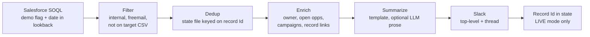

# demo-request-intel-agent

When a target account submits a demo-request form, post a short briefing to Slack so the account executive doesn't have to research the person first.

## The problem

An inbound demo request usually triggers a generic alert: a name and an email. Before an AE can decide how to respond, they spend around 30 minutes working out who this is, whether the company is on the target list, who owns the account, whether there is already an open deal, and how the person found you. That information is already in the CRM. It just isn't in front of the AE when the form comes in.

## What the Slack message looks like

One short top-level message per request, with the detail in a thread. All names below are fictional.

```
:dart: Target demo request: Acme Corp (Tier A)
Jordan Rivera · VP of Demand Generation · jordan.rivera@acme.test
ref:003FAKE000000001
  └─ thread:
     LinkedIn · Account owner: Sam Example

     How they got here
     Source: Paid Search · Medium: cpc · Campaign: brand-q1 · Term: marketing automation
     Landing page: https://example.test/pricing · Submitted: 2026-01-15

     Recent activity
     • Spring Webinar (Attended)
     • Product Newsletter (Sent)

     CRM
     Account · Open opp: Acme Corp - Expansion · Discovery · $48,000 · (Existing Business)
```

Account and opportunity names are links to the CRM records. Sections with no data are left out.

## Architecture



Every step before "Summarize" is plain code. The LLM, if you turn it on, only writes one short paragraph from the structured facts. It never decides who gets posted.

## Quick start

Requires Python 3.9+ and no third-party packages.

```sh
git clone <this repo> && cd demo-request-intel-agent
python3 -m unittest discover -s tests -t .          # no network needed
python3 -m demo_intel --fixture sample_data/sample_requests.json   # offline demo, prints messages
```

Against a real org:

```sh
cp config.example.json config.json    # edit field names, target list, Slack ids
export SLACK_BOT_TOKEN=...            # bot token with chat:write
# Salesforce auth: either export SF_INSTANCE_URL and SF_ACCESS_TOKEN,
# or set salesforce.sf_cli_org and log in with the Salesforce CLI.
python3 -m demo_intel --dry-run       # print what would post
python3 -m demo_intel                 # TEST: DM to test_user_id, prefixed [TEST]
python3 -m demo_intel --live          # LIVE: post to live_channel_id, record dedup state
```

Store tokens in a keychain or secrets manager and export them at run time. Don't put them in `config.json`.

### Scheduling

`run_local.sh` runs the pipeline in LIVE mode. `deploy/com.example.demo-intel.plist` is a launchd template that runs it hourly (edit the label and path, copy to `~/Library/LaunchAgents/`, then `launchctl load` it). On Linux, a cron line calling `run_local.sh` does the same job.

## Config

See `config.example.json`.

| Key | Meaning |
| --- | --- |
| `fields.demo_flag`, `fields.demo_date` | Contact fields that mark a demo request and its date. Example names; use your own. |
| `fields.source/medium/campaign/term/landing_page` | Attribution fields to show under "How they got here". Blank or "None" values are skipped. |
| `fields.linkedin` | LinkedIn URL field. |
| `lookback_days` | How far back to query (default 2). |
| `target_list` | CSV with `domain` and `tier` columns (and optional `company`). See `sample_data/`. |
| `internal_domains` | Your own domains. Always dropped. |
| `extra_freemail_domains` | Added to the built-in freemail list. |
| `low_fit_tiers` | Tiers that get a "low fit" caveat in the thread. |
| `state_path` | Dedup state file. |
| `slack.*` | Env var name for the bot token, test DM user id, live channel id. |
| `llm.*` | `enabled`, `model` (default `claude-sonnet-5-5`), `max_tokens`. Uses `ANTHROPIC_API_KEY`. |

## Design notes

- **Read demo requests from the CRM, not a form-submissions API.** The form writes to the CRM reliably and right away. The form platform's API we first used lagged by hours and dropped whole days.
- **Wide lookback plus deterministic dedup.** The window (2 days) tolerates delays and late-arriving records. A state file keyed on the CRM record Id prevents re-posts. Never dedup by having an LLM scan channel history; it misses refs, which causes both duplicates and gaps.
- **Filter before anything else.** Drop internal domains, freemail, and accounts not on the target list. Target lookup is by normalized domain (lowercased, `www.` and URL parts stripped), and falls back to the parent domain for subdomains.
- **Post nothing when there is nothing new.** No "0 requests" messages.
- **TEST by default.** Messages go to a DM, prefixed `[TEST]`, and do not write dedup state, otherwise a test run would suppress the real alert. LIVE needs the explicit `--live` flag. `--dry-run` prints instead of posting. `--fixture` is always a dry run.
- **The LLM writes prose only.** Selection, filtering, dedup and all facts come from code. If the API call fails for any reason, the message posts with the template alone.
- **Scheduled locally.** A cloud or headless runner may not have the same authenticated Slack and CRM access as your own machine. In the original setup the cloud runner could fetch but never post, so it runs from a local scheduler (launchd) with credentials the machine already has.
- **Read-only.** The tool never writes to the CRM. Its only writes are Slack posts and the local state file.

## Limitations

- Salesforce only, and it assumes a Contact-level demo-request flag and date. Other CRMs or Lead-based flows need a new source in `sfdc.py`.
- The demo date is treated as a date (day granularity), hence the 2-day default lookback.
- "Recent activity" is limited to campaign memberships. Web sessions and email engagement need your own source and aren't included.
- Slack message text is plain mrkdwn, not Block Kit.
- No retry or rate-limit handling beyond failing loudly. A failed post is not marked, so the next run retries it.
- The target list is a static CSV you maintain.
- Fixture mode and the tests cover the logic; the live Salesforce and Slack calls are not tested here.

## Layout

```
demo_intel/        pipeline modules (domains, targets, state, sfdc, enrich, render, slack, pipeline, cli)
claude-code/       the same flow as a Claude Code slash-command skill
sample_data/       fictional target list and request fixture
deploy/            launchd template
tests/             unittest suite, no network
```

## License

MIT
